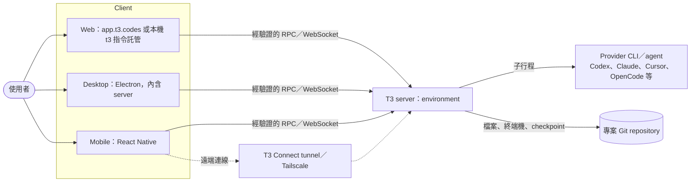

# 架構

T3 Code 是 coding agent 的 GUI：一個 Node WebSocket server 包裝各 provider 的 CLI 與 agent，供 web、desktop、mobile 三種 client 連線控制。本文件是 fork 端的中文導覽；架構決策與限制的權威版本在 upstream 維護的 [`docs/internals/overview.md`](internals/overview.md)，兩者衝突時以該檔與原始碼為準。

來源：[`AGENTS.md`](../AGENTS.md)、[`docs/internals/overview.md`](internals/overview.md)

## 系統脈絡（C4 Context）

- 執行永遠留在擁有 workspace 的 environment；遠端 client 不能以自己的檔案系統、provider credential 或機器狀態取代 environment 的。來源：[`docs/internals/overview.md`](internals/overview.md)
- Desktop 內含 server，但其 renderer 遵守同一邊界，也可作為遠端連線的主機。來源：[`AGENTS.md`](../AGENTS.md)「Multi-surface」
- 遠端連線方式：區域網路直連、Tailscale、T3 Connect。來源：[`AGENTS.md`](../AGENTS.md)「Remote ready」、[`docs/internals/t3-connect.md`](internals/t3-connect.md)

## 容器與程式位置（C4 Container）

| 容器                  | 位置                                                                             | 職責                                                                       | 來源                                                              |
| --------------------- | -------------------------------------------------------------------------------- | -------------------------------------------------------------------------- | ----------------------------------------------------------------- |
| Server（套件名 `t3`） | `apps/server`                                                                    | WebSocket、orchestration、provider adapter、checkpoint                     | `apps/server/package.json`、`AGENTS.md`「Where code lives」       |
| Web                   | `apps/web`                                                                       | React／Vite UI                                                             | `apps/web/package.json`、`AGENTS.md`                              |
| Desktop               | `apps/desktop`                                                                   | Electron 外殼，包裝 web 並內含 server                                      | `apps/desktop/package.json`、`AGENTS.md`                          |
| Mobile                | `apps/mobile`                                                                    | React Native（iOS、Android）                                               | `apps/mobile/package.json`、`AGENTS.md`                           |
| Marketing             | `apps/marketing`                                                                 | 官網                                                                       | `apps/marketing/package.json`                                     |
| 契約                  | `packages/contracts`                                                             | Effect/Schema 定義的 wire 型別（RPC 邊界）                                 | `AGENTS.md`、`packages/contracts/src/rpc.ts`                      |
| Client 共用執行期     | `packages/client-runtime`                                                        | web 與 mobile 共用的連線與領域狀態                                         | `AGENTS.md`、`docs/internals/overview.md`                         |
| 共用工具              | `packages/shared`                                                                | 共用 runtime utils（subpath exports，無 barrel）                           | `AGENTS.md`                                                       |
| Provider 套件         | `packages/provider-*`、`packages/effect-acp`、`packages/effect-codex-app-server` | 各 provider 的協定轉譯                                                     | `pnpm-workspace.yaml`、`package.json` 的 `knip:check:exports`     |
| Source control 套件   | `packages/source-control-*`                                                      | GitHub、GitLab、Bitbucket、Azure DevOps、Forgejo 等 forge 整合             | `package.json` 的 `knip:check:exports`                            |
| Secret provider       | `packages/secret-provider-*`                                                     | 祕密來源（含 1Password）                                                   | `package.json` 的 `knip:check:exports`                            |
| 原生元件              | `native/*`                                                                       | Rust crate（`resource-monitor`、`hyprland-snap-shot`、`kde-snap-shot` 等） | `native/*/Cargo.toml`、`package.json` 的 `build:resource-monitor` |
| 參考 repo             | `.repos/`                                                                        | 唯讀的 vendored 參考程式碼，不可修改或 import                              | `AGENTS.md`「Where code lives」                                   |

## 請求如何流動

1. Client 送出型別化的 WebSocket request，server 把它轉成 command。
2. Orchestrator（`apps/server/src/orchestration-v2/Orchestrator.ts`）序列化 command，並在不做任何 I/O 的情況下決定 event。
3. EventSink 在同一個資料庫 transaction 內提交 event、projection、command receipt 與 outbox effect。
4. Effect worker 在 commit 之後執行副作用（例如啟動 provider turn、擷取 checkpoint），再把結果以 command 回饋。
5. Provider CLI 以子行程執行；各 provider adapter 把原生協定轉成 orchestration event。
6. 每個 turn 以 checkpoint 結束：一個隱藏的 Git ref，讓 app 可以 diff 與還原，不會在使用者分支上新增 commit。

來源：[`AGENTS.md`](../AGENTS.md)「How it works」、[`docs/internals/overview.md`](internals/overview.md)「Durable intent and side effects」「Turn completion and checkpoints」

需要特別注意的限制（細節見 overview）：

- command 被確認只代表意圖已提交，不代表 provider 或 checkpoint 已完成。
- event log 只保留約一天，projection 無法從 log 重建；保留的 event 必須在 replay 時仍可解碼，改 schema 要考慮舊資料。
- Provider 特有行為放在 adapter 後面，orchestration 只處理正規化後的 command 與 event。

## 延伸閱讀

- 詞彙表：[`docs/internals/glossary.md`](internals/glossary.md)
- 連線執行期：[`docs/internals/connection-runtime.md`](internals/connection-runtime.md)
- Provider 限制與新增 provider：[`docs/internals/providers.md`](internals/providers.md)、[`docs/internals/adding-a-provider.md`](internals/adding-a-provider.md)
- Effect 服務寫法：[`docs/internals/effect-services.md`](internals/effect-services.md)
- Orchestration v2 設計：[`docs/orchestration-v2/README.md`](orchestration-v2/README.md)
